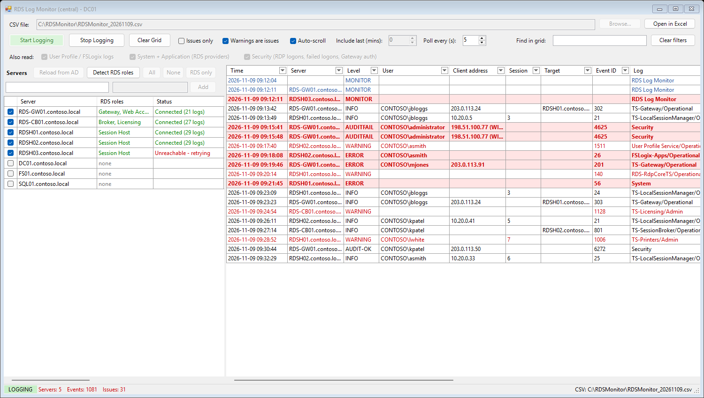
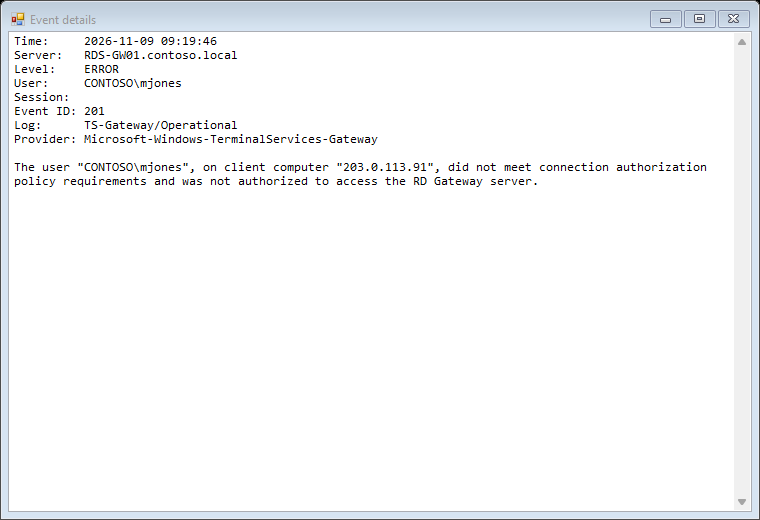
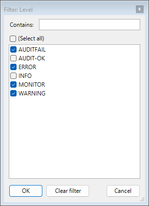
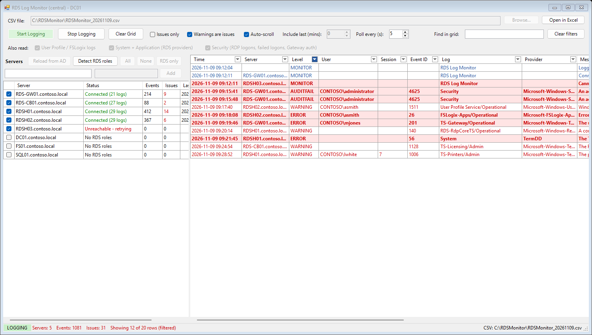

# RDS Log Monitor

> [!WARNING]
> **This app was written by AI (Claude) for my own personal use.**
> It has not been professionally reviewed or audited. You're free to use, copy and modify it,
> but **entirely at your own risk**. It comes with no warranty and no support, and I accept no
> responsibility for any data loss, security issues or other problems that result from using it.
> Released under the [MIT License](LICENSE).

RDS Log Monitor watches the Remote Desktop Services (RDS) event logs on every RDS server in a domain from one place. You run it on a domain controller or management server. It finds the servers in Active Directory, reads their logs over the network, and writes every event to one grid and one CSV file. Errors and failed logons are highlighted in red so they stand out.

It is a single PowerShell script with a Windows Forms interface. There is nothing to install on the RDS servers.



Screenshots in this guide use sample data from a test domain (contoso.local).

## What it does

- Lists the Windows Servers in Active Directory and detects which ones have Remote Desktop roles (Session Host, Gateway, Connection Broker, Licensing, Web Access).
- Reads the RDS event logs on each ticked server in the background. A slow or offline server does not hold up the others or freeze the window.
- Shows every event in one grid with columns for time, server, level, user, client address, session, target, event ID, log, provider and message.
- Highlights issues: errors, critical events and audit failures in bold red on a pink background, and warnings in red.
- Writes everything to one CSV file that opens cleanly in Excel.
- Filters and sorts the grid like an Excel table, with a filter button on every column.
- Reconnects to servers that go offline and carries on from the last event it read, so nothing is missed.

## Requirements

| Where | What is needed |
|---|---|
| The machine running the app | Windows PowerShell 5.1 (included with Windows Server 2016 and later). Domain-joined, so it can query Active Directory. |
| Account running the app | Administrator on the RDS servers, or a member of their Event Log Readers group. Either one can read the Security log. |
| RDS servers | The Remote Event Log Management firewall rules enabled. See [Troubleshooting](#troubleshooting). |
| RDS servers, for role detection only | Windows Remote Management (WinRM), which is on by default on Windows Server. The app falls back to DCOM if WinRM is unavailable. |

## Getting started

1. Download `RDSLogMonitor.ps1` and `Start-RDSLogMonitor.cmd` from this repository.
2. Copy both files to the same folder on the domain controller or management server, for example `C:\Tools\RDSLogMonitor`.
3. If the files were downloaded from the internet, unblock them: right-click each file, choose Properties, tick Unblock and click OK.
4. Double-click `Start-RDSLogMonitor.cmd`. The window opens without a console.

To run it from PowerShell instead:

```powershell
powershell.exe -NoProfile -ExecutionPolicy Bypass -STA -File .\RDSLogMonitor.ps1
```

## Using the app

### Choose the servers

The Servers panel on the left loads every enabled Windows Server from Active Directory when the app opens.

| Control | What it does |
|---|---|
| Reload from AD | Reads the server list from Active Directory again. |
| Detect RDS roles | Asks each listed server which Remote Desktop roles it has, fills in the RDS roles column and ticks the servers that have one. |
| All / None | Ticks or unticks every server in the list. |
| RDS only | Ticks only the servers with a detected RDS role. |
| Filter box (left) | Narrows the list by name, role, operating system or OU. |
| Add box (right) | Adds a server by name, for one that is not in Active Directory. Press Enter or click Add. |

Your ticked servers, detected roles, CSV path and options are saved and restored next time.

### Start and stop logging

1. Check the CSV file path at the top, or click Browse to choose another. The default is `C:\RDSMonitor\RDSMonitor_<date>.csv`.
2. Choose the extra logs to read under Also read (see [Logs it reads](#logs-it-reads)).
3. Optionally set Include last (mins) to pull in recent history when logging starts. Leave it at 0 to show only new events.
4. Click Start Logging.

Each server's Status column shows Connecting, Connected (with the number of logs it is watching), or Unreachable. The Events and Issues columns count what has come in from each server. Click Stop Logging to stop; the CSV is saved as you go, so nothing is lost when you stop.

### Options

| Option | What it does |
|---|---|
| Issues only | Records only errors, critical events, audit failures and warnings (when warnings count as issues). Applies to the grid and the CSV. |
| Warnings are issues | Shows warnings in red and counts them as issues. Untick to show warnings in orange instead. |
| Auto-scroll | Keeps the newest events in view. |
| Poll every (s) | How often each server is checked for new events. The default is 5 seconds. |

### Read the grid

| Colour | Meaning |
|---|---|
| Bold red on pink | Error, critical event or audit failure (for example a failed RDP logon), or a problem with the monitor itself, such as a server it cannot reach |
| Red | Warning, when Warnings are issues is ticked |
| Blue | Message from the monitor, such as a server connecting |
| Black | Information |

Double-click a row, or right-click it and choose Show full details, to see the whole event.



To copy rows, select them and right-click, then choose Copy selected rows. They paste into Excel with headings.

### Filter and sort

Every column heading has a filter button on its right-hand side. Click it to choose which values to show, or type in Contains to match part of a value. The Time column filters by day.



The filter button turns blue while a filter is on. Filters on different columns combine, and they also combine with the Find in grid box, which searches across all columns. The status bar shows how many rows are visible. Click Clear filters to remove them all.



Click anywhere else on a column heading to sort by that column; click again to reverse the order.

Filters and sorting only change what you see. The CSV always receives every event.

### Open the CSV in Excel

Click Open in Excel. The app opens a copy of the CSV, so Excel does not lock the file the app is still writing to.

If you open the live CSV in Excel directly, the app cannot write to it while it is open. New rows are kept in memory, the status bar shows how many are waiting, and they are saved when you close the file.

## Logs it reads

| Source | What is read | Option |
|---|---|---|
| RDS logs | Every Admin and Operational log whose name contains TerminalServices, RemoteDesktopServices, RemoteApp or Rdms. This covers Session Host, Gateway, Connection Broker, Licensing, RdpCoreTS, printer redirection and more. Only logs that exist and are enabled on each server are read. | Always |
| Profile logs | User Profile Service and FSLogix logs, where present | User Profile / FSLogix logs |
| System and Application | Only events from RDS-related sources, such as TermService, TermDD and licensing | System + Application (RDS providers) |
| Security | RDP logons and failed logons (event IDs 4624 and 4625, logon type 10), session reconnects and disconnects (4778 and 4779), and RD Gateway network policy grants and denials (6272 and 6273) | Security |

Client-side Remote Desktop logs are skipped. So are Analytic and Debug logs, which are verbose diagnostic channels.

## CSV columns

| Column | Contents |
|---|---|
| Time | When the event happened, as `yyyy-MM-dd HH:mm:ss` in the monitoring machine's local time |
| Server | The server the event came from |
| Level | INFO, WARNING, ERROR, CRITICAL, AUDIT-OK, AUDITFAIL, or MONITOR for the app's own messages |
| Issue | Yes or No |
| User | The user the event is about, taken from the event data (for example `CONTOSO\jbloggs`) |
| ClientAddress | The client IP address, with the client computer name in brackets when the event records it |
| SessionId | The Remote Desktop session ID |
| Target | For RD Gateway and Connection Broker events, the server the user was connecting to |
| EventId | The Windows event ID |
| Log | The event log, shortened (for example `TS-Gateway/Operational`) |
| Provider | The source that wrote the event |
| Message | The full event message on one line, with line breaks shown as a vertical bar (\|) |

The file is UTF-8 with a header row. The app adds to an existing file instead of overwriting it. Values that Excel would treat as a formula, such as a username starting with `=`, are prefixed with an apostrophe so they display as plain text.

## Troubleshooting

### "Cannot connect: The RPC server is unavailable"

The monitoring machine cannot reach the server's event log service. If the server is online, its firewall is almost always the cause: the Remote Event Log Management rules are off.

Check whether port 135 is reachable:

```powershell
Test-NetConnection RDSH01.contoso.local -Port 135
```

Turn the rules on for one or more servers. This runs over WinRM, which is normally open even when RPC (remote procedure call) is blocked:

```powershell
Invoke-Command -ComputerName RDSH01.contoso.local, RDSH02.contoso.local { Enable-NetFirewallRule -DisplayGroup 'Remote Event Log Management' }
```

To turn them on for every enabled server in Active Directory:

```powershell
$servers = (Get-ADComputer -Filter 'OperatingSystem -like "*Server*" -and Enabled -eq $true' -Properties DNSHostName).DNSHostName
Invoke-Command -ComputerName $servers -ThrottleLimit 32 { Enable-NetFirewallRule -DisplayGroup 'Remote Event Log Management' }
```

A Group Policy refresh can turn local firewall changes off again. For a lasting fix, enable the predefined Remote Event Log Management inbound rule in a Group Policy Object linked to the servers' OU.

You do not need to restart the app. It retries unreachable servers every 60 seconds.

### "Access denied reading Security"

The account running the app is not an administrator on that server and is not in its Event Log Readers group. The other logs carry on; only the Security log is skipped.

### "Could not read servers from Active Directory"

The machine cannot contact a domain controller, for example because it is off the domain network. Add servers by name with the Add box instead.

### RDS roles shows "unknown"

The server did not answer over WinRM or DCOM. Hover over the cell to see the error. You can still tick the server and monitor it; role detection only helps you choose.

## Test one server from the command line

`-Probe` connects to one server, lists the logs it would watch and shows the last hour of events with the user and client fields filled in. No window opens. Use it to confirm firewall and permissions before you start the app.

```powershell
.\RDSLogMonitor.ps1 -Probe RDSH01.contoso.local
```

## Notes

- Settings are saved to `%APPDATA%\RDSLogMonitor\settings.json` for the user running the app.
- The grid keeps the latest 20,000 rows. The CSV keeps everything.
- Each server is checked for up to 2,000 new events per log per poll. A larger backlog, for example from a long Include last setting, is read over the following polls.
- If a log is cleared on a server, the app notices and reads it again from the start.
